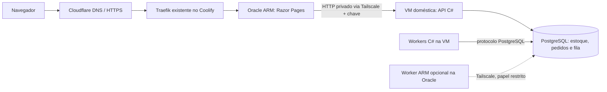

# Arquitetura e integridade

O site e o painel são um único ASP.NET Core com Razor Pages. O checkout renova seu token antiforgery antes de enviar, inclusive quando o operador fez login administrativo em outra aba depois de abrir a loja. O navegador acessa o mesmo domínio; chaves da API permanecem no servidor web. A página da loja carrega mesmo sem API e limita suas chamadas a quatro segundos. A API aceita pedidos e responde 202 com ID; o site consulta o status. O catálogo pode estar desatualizado: a validação definitiva ocorre ao reservar.

Não há Redis, broker externo, Kubernetes ou GPU. A fila é a tabela `orders`; os itens e preços são snapshots em `order_items`. Valores são `decimal`/`numeric`, calculados no backend. O cliente é sempre fictício. O pagamento é determinístico e recusa aproximadamente 5% dos pedidos; não existe efeito financeiro externo.

## Processo, thread, worker e núcleo

- **Processo** tem memória própria e PID. Cada contêiner worker inicia um processo .NET.
- **Thread** é uma unidade de execução dentro do processo. A versão paralela cria `System.Threading.Thread` dedicadas e síncronas. Timers auxiliares fazem heartbeat/renovação; não processam a carga de pedidos.
- **Worker** é o programa consumidor. No distribuído cada instância processa um pedido de cada vez; no paralelo uma instância eleita hospeda as threads de processamento.
- **Núcleo/vCPU** é recurso de execução do hardware/hipervisor. O SO agenda as threads. Oito threads não criam oito núcleos e uma Task não equivale a uma thread exclusiva.

No sequencial, apenas um processo obtém o advisory lock 7100 e usa uma thread. No paralelo, o mesmo lock elege um processo que cria N threads. No distribuído, processos independentes disputam os locks 7200…7202; cada processo mantém um slot. O banco também limita o número global de pedidos com posse vigente. O número de processos configurado deve corresponder aos contêineres disponíveis; uma configuração de três com dois contêineres não cria o terceiro.

A unidade de divisão é um pedido. Pedidos distintos podem validar e executar CPU simultaneamente; a dependência compartilhada é o estoque, protegido pelo banco. As threads retiram dinamicamente o próximo pedido disponível, equilibrando o trabalho sem partições fixas. Cada pedido preserva a ordem validar → reservar → calcular/pagar → concluir. A consolidação aguarda todos os estados finais e agrega resultados do lote no PostgreSQL; o executor C# exporta os resultados e calcula as médias das repetições.

## Transações do pedido

1. **Admissão:** normaliza o carrinho, calcula seu hash, trava admissão (`pg_advisory_xact_lock(7001)`), verifica a chave idempotente e o limite de pedidos não finalizados, insere pedido e itens e faz commit. Mesma chave/carrinho retorna o mesmo ID; mesma chave com outro carrinho retorna 409. Há constraint UNIQUE como segunda proteção. Produtos/quantidades inválidos retornam 400.
2. **Claim/reserva:** trava admissão em modo compartilhado e um pequeno mutex de claim 7002. Confere configuração, slot de coordenação e limite global. Seleciona pedido pendente ou com lease vencido por `FOR UPDATE SKIP LOCKED`. Bloqueia os produtos em ordem crescente e valida todos antes de reduzir o estoque. Sem estoque, registra RECUSADO e um evento final. Com estoque, persiste a reserva, token, worker, prazo e tentativa. Faz commit **antes da CPU**.
3. **CPU/pagamento:** `Processor.Process` executa a mesma cadeia SHA-256 em qualquer modo. Falha fictícia foi definida ao criar o pedido. Um timer renova o prazo a cada 2 s. Atraso visual é independente e opcional. Nenhuma transação fica aberta durante a CPU.
4. **Conclusão:** bloqueia o pedido com status/token atual. Se o token foi substituído, não altera nada. Em caso de pagamento recusado, bloqueia produtos na mesma ordem e devolve a reserva. Atualiza o estado final, digest, tempos e thread ID; grava evento FINALIZADO e faz commit. Um índice único impede dois eventos finais por pedido.

Dentro de cada contêiner o processo pode ter **PID 1**. Isso não significa que os workers sejam o mesmo processo: cada contêiner tem seu namespace de PID e hostname próprio. Use nomes dos contêineres/hostnames e `docker top` para distinguir os processos no host. IDs de threads também podem se repetir entre processos.

## Falhas e recuperação

Pedido aceito já está persistido. Se o processo parar antes do commit da reserva, a transação é desfeita. Se parar depois, a reserva permanece associada ao pedido. Após 15 s sem renovação outro worker retoma **a mesma reserva** e gera um novo token. O resultado do worker antigo é rejeitado. Se parar depois do commit final, o pedido não volta à fila. Se o cliente perder a resposta HTTP, reenvia a mesma chave, conservada no navegador até o estado final.

As garantias são **tentativas pelo menos uma vez e efeitos finais únicos**. Pode haver cálculo CPU repetido após perda de comunicação ou expiração da posse. Não se promete execução física exatamente uma vez nem ausência absoluta de sobreposição de cálculo durante partições; tokens impedem corrupção persistida. Um pagamento externo exigiria idempotência também no provedor, fora do escopo.

A conta de estoque considera: estoque inicial = disponível + reservas vigentes + quantidade de vendas aprovadas. Recusas sem estoque não reservam. Recusas de pagamento liberam a reserva na mesma transação da finalização. Constraints impedem estoque negativo e aprovação com pagamento marcado como falho.

## Limites e segurança

PostgreSQL é um ponto único de falha: sua queda suspende o processamento; o volume conserva os dados. Não há replicação nem failover do banco. A API retorna 503 em falhas de conexão. Corrigir a conexão/reiniciar o banco permite retomar; dados já confirmados permanecem. Faça backups; volume persistente não substitui backup.

Chaves diferentes protegem chamadas de serviço e administração. O painel usa cookie HttpOnly, SameSite Strict, senha, limite de tentativas e antiforgery. Mutações administrativas são POST/PUT e exigem autenticação. Não há rota de shell nem acesso ao socket Docker pelo site. O limite de fila é global e previsível; o site também limita a taxa HTTP para proteger o laboratório. As páginas não dependem de CDN.

Configurações e reposição só mudam com fila e benchmark inativos, sob a mesma trava da admissão. O benchmark restaura estoque e publica todo o lote em uma transação; compras públicas ficam suspensas durante sua execução. Resultados antigos são preservados. O esquema inicial é criado de forma idempotente; futuras mudanças de estrutura devem ter migrações versionadas antes de atualizar instalações existentes.

## Diagnóstico de CPU e limites aplicados

O limite de cálculo é diferente do total de threads do SO e da CPU somada da VM. O painel mostra a configuração aplicada, o papel de cada worker, threads de cálculo e CPU específica do processo. Os picos são reiniciados por configuração. A espera da fila vazia usa backoff até 1 s; a verificação de mudanças ocorre no supervisor a cada 500 ms. A reserva ainda valida os limites na mesma transação. Consulte [validação de concorrência e Beszel](validacao-concorrencia.md) para dados medidos, reprodução e afinidade opcional.
