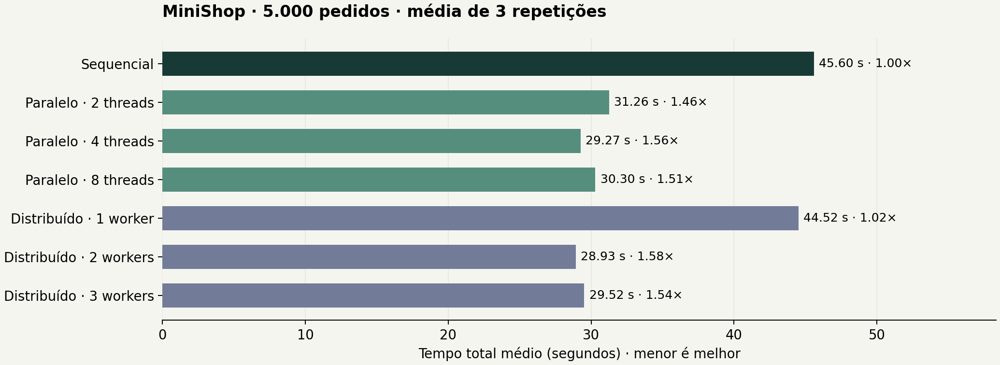

# Campanha histórica de desenvolvimento

Linux amd64, 3 processadores disponíveis, Docker, 20/10/2026 UTC. **5.000 pedidos × 3 repetições, 5.000 iterações SHA-256, atraso zero**. Esta campanha não foi executada no hardware final.

| Cenário | Média (s) | Speedup |
|---|---:|---:|
| Sequencial | 45.602 | 1.00× |
| Paralelo · 2 threads | 31.256 | 1.46× |
| Paralelo · 4 threads | 29.265 | 1.56× |
| Paralelo · 8 threads | 30.296 | 1.51× |
| Distribuído · 1 worker | 44.525 | 1.02× |
| Distribuído · 2 workers | 28.928 | 1.58× |
| Distribuído · 3 workers | 29.523 | 1.54× |

CSV, JSON e exportações auditáveis estão em `results/reference-codex/`. Repita no hardware final; o padrão do projeto usa uma carga dez vezes maior.
